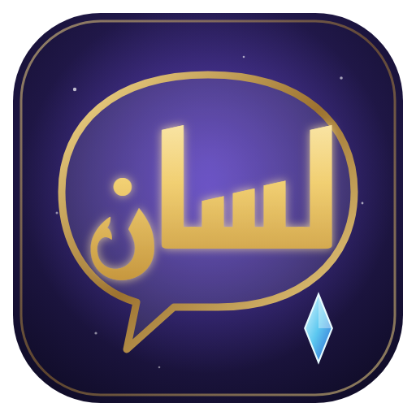

<p align="center">
  
</p>

# Lisan

[](https://github.com/dev-habsi/Lisan/actions/workflows/build.yml) [](https://github.com/dev-habsi/Lisan/releases/latest) [](LICENSE)  

**Lisan** (لسان: tongue, language) is a [Dalamud](https://github.com/goatcorp/Dalamud) plugin for Final Fantasy XIV that translates NPC dialogue from English into your language, **offline, on your own PC**. Talk balloons, battle talk, cutscene subtitles, dialogue choices and Yes/No prompts are rewritten in place. Default language is Arabic; 26 languages are built in and any Hugging Face Opus-MT model can be used.

Made with love at [habsi.net](https://habsi.net).

| | |
|---|---|
| **Version** | 1.0.1 |
| **Dalamud** | API 15 (.NET 10) |
| **Platform** | Windows. Setup has no Windows-only scripts; on Linux (Wine) the translator needs a Windows Python inside the Wine prefix (untested). Optional TTS is Windows-only. |
| **License** | AGPL-3.0-or-later (models and fonts have their own licenses, see [THIRD_PARTY_NOTICES.md](THIRD_PARTY_NOTICES.md)) |

---

## Install (players)

You need: FFXIV via **XIVLauncher** with Dalamud, **Python 3.10 or newer** on PATH, about **1.5 GB of disk** (PyTorch + one language pack) and internet for the one-time download.

1. **Install Python** from https://www.python.org/downloads/windows/ and tick **"Add python.exe to PATH"** in the installer. Skip if `python --version` already works in a terminal.
2. In game: **Dalamud Settings → Experimental → Custom Plugin Repositories**, paste this URL, press **+**, then **Save and Close**:

   ```
   https://raw.githubusercontent.com/dev-habsi/Lisan/main/pluginmaster.json
   ```

3. **Plugin Installer → search "Lisan" → Install.**
4. The Lisan window opens on its **Setup** tab (or type `/lisan config`). Pick your language, click **Download … pack + Python packages**, wait for *Done* (PyTorch is ~200 MB, a pack ~300 MB; a few minutes on a normal connection). The translator restarts by itself.
5. Keep the **game client language on English** (that is the source text). Talk to an NPC. The first line after a game start takes 10–30 s while the model loads; after that lines are near-instant and repeated lines come from cache.

That is all. Packs are stored in `%AppData%\XIVLauncher\pluginConfigs\Lisan\Models` and survive plugin updates.

**Switching language later:** General tab → Target language (or `/lisan lang ja`). If that pack is not downloaded yet, the Setup tab tells you and downloads it.

---

## Languages

| Code | Language | Model | Font |
|------|----------|-------|------|
| `ar` | Arabic (default) | `Helsinki-NLP/opus-mt-en-ar` | Noto Naskh Arabic (bundled) |
| `de` | German | `opus-mt-en-de` | — |
| `es` | Spanish | `opus-mt-en-es` | — |
| `it` | Italian | `opus-mt-en-it` | — |
| `pt` | Portuguese | `opus-mt-tc-big-en-pt` (`>>por<<`) | — |
| `nl` | Dutch | `opus-mt-en-nl` | — |
| `pl` | Polish | `opus-mt-en-sla` (`>>pol<<`) | — |
| `ru` | Russian | `opus-mt-en-ru` | — |
| `uk` | Ukrainian | `opus-mt-en-uk` | — |
| `tr` | Turkish | `opus-mt-tc-big-en-tr` | — |
| `sv` | Swedish | `opus-mt-en-sv` | — |
| `da` | Danish | `opus-mt-en-da` | — |
| `fi` | Finnish | `opus-mt-en-fi` | — |
| `cs` | Czech | `opus-mt-en-cs` | — |
| `ro` | Romanian | `opus-mt-en-ro` | — |
| `hu` | Hungarian | `opus-mt-en-hu` | — |
| `el` | Greek | `opus-mt-en-el` | — |
| `bg` | Bulgarian | `opus-mt-en-bg` | — |
| `ja` | Japanese | `opus-mt-en-jap` | Noto Sans CJK JP |
| `zh` | Chinese (Simplified) | `opus-mt-en-zh` (`>>cmn_Hans<<`) | Noto Sans CJK SC |
| `ko` | Korean | `opus-mt-tc-big-en-ko` (`>>kor<<`) | Noto Sans CJK KR |
| `vi` | Vietnamese | `opus-mt-en-vi` | — |
| `id` | Indonesian | `opus-mt-en-id` | — |
| `fa` | Persian | `opus-mt-en-mul` (`>>pes<<`) | Noto Naskh Arabic |
| `hi` | Hindi | `opus-mt-en-hi` | Noto Sans Devanagari |
| `th` | Thai | `opus-mt-en-mul` (`>>tha<<`) | Noto Sans Thai |
| `custom` | Any Hugging Face repo | you choose | optional |

All models are by [Helsinki-NLP](https://huggingface.co/Helsinki-NLP). Target tokens in parentheses are sent automatically. Persian and Thai use the multilingual `en-mul` model, which is noticeably weaker than a dedicated pair.

**Custom model:** General → Target language → *Custom model folder*, then on the Setup tab enter a repo id such as `Helsinki-NLP/opus-mt-en-fr` and download. If the model card says a `>>xxx<<` token is required, put it in General → Custom pack → Opus token; tick *Right-to-left* for RTL scripts.

Translation quality is machine translation (Marian / Opus-MT, CPU). It is good for everyday dialogue and weaker on lore names and poetry.

---

## Commands and hotkeys

| Command | Action |
|---------|--------|
| `/lisan` | Toggle translation on/off |
| `/lisan config` | Open settings (Setup, General, Translator, Debug) |
| `/lisan history` | Dialogue history (filter, copy, speak, export) |
| `/lisan copy` | Copy the last translation to the clipboard |
| `/lisan speak` · `/lisan stop` | Replay / stop Arabic TTS |
| `/lisan export` | Write `lisan-history.txt` to the plugin config folder |
| `/lisan lang` · `/lisan lang de` | Show / switch language |
| `/lisan status` · `/lisan help` | Status line / command list |
| `/lisan test` | Translate a sample line onto the open balloon |

Hotkeys (on by default, General tab): **Ctrl+Alt+C** copy, **Ctrl+Alt+H** history, **Ctrl+Alt+S** speak, **Ctrl+Alt+X** stop TTS.

## Settings

- **Setup**: Python check, pack + font download with live log, open models folder.
- **General**: enable, target language, which dialogue types to translate, history / auto-copy / hotkeys, balloon font size and text color.
- **Translator**: worker status and model path, fast (greedy) vs. 2-beam decoding, warm-up on load, optional **Arabic Windows TTS** (needs a Desktop Arabic voice such as Microsoft Huma or Naayf), custom model folder, clear cache, restart worker.
- **Debug**: log each translation to the Dalamud log, live view of the current line.

---

## Privacy

Lisan sends nothing to a translation service. Text is read from the game UI, sent to a local Python process over stdin/stdout, and written back. The only network use is during setup: PyPI (PyTorch, transformers), Hugging Face (the model) and GitHub (Noto fonts). You can also copy a pack into the models folder by hand and never go online.

Cache and history live in `%AppData%\XIVLauncher\pluginConfigs\Lisan\` (`dialogue-cache.json`, `dialogue-history.json`). Delete them any time.

## How it works

```
Talk / _BattleTalk / TalkSubtitle / SelectString / SelectYesno (game addons)
        │  IAddonLifecycle PostDraw / PostRefresh
        ▼
 AddonDialogueWatcher  ── cache hit ──► text node rewritten (Latin/Cyrillic/Greek scripts)
        │                              or hidden + drawn with a plugin font (Arabic, CJK, Devanagari, Thai)
        └─ LocalTranslator ── {"cmd":"tr","text":…} ──► translate_worker.py (transformers, CPU)
```

The Python worker stays alive for the whole session, so only the first line pays the model load. Long lines are split into sentences and packed under the 512-token Marian limit.

---

## Troubleshooting

| Problem | Check |
|--------|-------|
| Setup tab says **Python: not found** | Install Python 3.10+ with *Add to PATH*, restart the game (PATH is read at start), click Recheck. |
| Setup fails at **torch install** | Read the log: no internet, proxy, or disk full. `pip` is retried with `--user` automatically for admin-installed Pythons. Run `python -m pip install torch --index-url https://download.pytorch.org/whl/cpu` in a terminal to see the full error. |
| Setup fails at **model download** | Wrong custom repo id, or Hugging Face unreachable. The pack folder is listed on the Setup tab; you can also download the files there by hand (`config.json`, `*.spm`, `vocab.json`, `pytorch_model.bin` or `model.safetensors`). |
| Translator status **Model missing** | Download the pack for the selected language on the Setup tab, or set *Custom model folder* on the Translator tab to a folder containing `config.json`. |
| Translator status **Worker failed: …** | The message is the last line Python printed. `No module named transformers` → run Setup again; `DLL load failed` → reinstall Python 3.10–3.12 64-bit. |
| Balloon stays English | Plugin enabled? That dialogue type ticked on General? Translator status *Ready*? Game language English? |
| Empty boxes (tofu) for Japanese / Chinese / Arabic / Thai | Overlay font missing: Setup tab shows it red; run the download again (fonts come from GitHub). |
| Arabic shown left-to-right or unjoined | Language must be `ar` / `fa`, or Custom with *Right-to-left* ticked. |
| Old translations after changing quality settings | Translator → *Clear translation cache*. |
| TTS says no Arabic voice | Windows Settings → Time & language → Speech → add an Arabic **Desktop** voice (Huma / Naayf), then *Recheck voice*. |

Logs: `/xllog` in game, or `%AppData%\XIVLauncher\dalamud.log`. Enable *Log each translation* on the Debug tab when reporting a bug and attach the relevant lines.

---

## Build from source / contribute

See [CONTRIBUTING.md](CONTRIBUTING.md). Short version:

```
git clone https://github.com/dev-habsi/Lisan.git
cd Lisan/Lisan
dotnet build -c Release -p:Platform=x64
```

Releases are cut by tagging `vX.Y.Z`; the GitHub Actions workflow builds the zip and updates `pluginmaster.json`.

## Credits

- [Helsinki-NLP Opus-MT](https://huggingface.co/Helsinki-NLP) models (Tiedemann & Thottingal, 2020)
- [ArabicRt](https://github.com/balswyan/arabic-rt-dotnet) Arabic shaping (MPL-2.0)
- [Noto fonts](https://fonts.google.com/noto) (SIL OFL 1.1)
- [Dalamud](https://github.com/goatcorp/Dalamud) and [FFXIVClientStructs](https://github.com/aers/FFXIVClientStructs)

Lisan is a fan-made tool. FINAL FANTASY XIV © SQUARE ENIX CO., LTD. Not affiliated with or endorsed by Square Enix. Use of third-party tools is at your own risk under the game's terms of service; Lisan only rewrites UI text on your screen and automates nothing.
